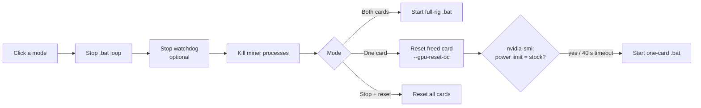

# ⛏️ Miner Mode

**One click to free your GPU for gaming, and one click to put it back to work.**

Miner Mode is a small Windows desktop app for people who mine with [SRBMiner-Multi](https://github.com/doktor83/SRBMiner-Multi) on a two-GPU NVIDIA rig and also use that PC for games or local AI models. It replaces this ritual:

> close the miner → edit the `.bat` → restart it on one card → open MSI Afterburner → hit reset so the freed card isn't stuck on mining clocks → start the game … and do it all again in reverse afterwards

with three buttons.

```
┌──────────────────────────────────────────────────────────┐
│  Mining: both cards                                      │
│  3070 ti        91.7 TH/s                                │
│  3060           53.7 TH/s                                │
│  shares 13 ok / 0 rejected                               │
│  power limit: GPU0 180/290 W  GPU1 112/170 W             │
│                                                          │
│ ┌──────────────┐ ┌──────────────────┐ ┌───────────────┐ │
│ │  Both cards  │ │    3060 only     │ │  Stop mining  │ │
│ │(full mining) │ │(free the 3070 Ti)│ │  + reset all  │ │
│ └──────────────┘ └──────────────────┘ └───────────────┘ │
│  3070 Ti reset to stock, 3060 mining.                    │
└──────────────────────────────────────────────────────────┘
```

---

## ✨ Features

### 🔀 Three modes, one click each
| Button | What happens |
|---|---|
| **Both cards** | Stops whatever is running and starts your full-rig `.bat` with your own overclock |
| **One card only** | Stops mining, **resets the freed card to stock**, then mines on the other card only. Game or run a local LLM on the freed card |
| **Stop mining + reset all** | Stops everything and returns **every** card to stock |

Button labels use your own card names from the config ("3060 only / free the 3070 Ti").

### 🧹 Automatic return to stock clocks, without Afterburner
SRBMiner **leaves its overclock applied after it exits**: core/memory offsets, power limit and fan speed all stay. A card you free for a game keeps running at mining settings (for example, a 3070 Ti capped at 180 W instead of 290 W) until you reset it by hand.

Miner Mode resets it for you. It briefly runs SRBMiner on **only the freed card** with its own `--gpu-reset-oc` option, then stops it the moment `nvidia-smi` reports the card's **default power limit**. The reset is checked against the card itself, not assumed. If it can't be confirmed within 40 seconds, the app says so plainly ("reset NOT confirmed: check Afterburner").

### 📊 Live status, every 5 seconds
- Current mode: *both cards*, *one card only* or *not mining*, read from the processes actually running, not from what was last clicked
- Per-card hashrate and accepted/rejected shares from SRBMiner's built-in API
- Each card's **current vs. stock power limit**, so you can see at a glance whether a card is still on mining settings

### 🛡️ Built to not break your rig
- **Clean switching order.** It stops the `.bat` restart loop *first*, so the old miner can't respawn mid-switch, then an optional watchdog, then every miner process. The new mode starts only after that.
- **No double switching.** Buttons lock while a switch runs, and a second click is ignored.
- **One window only.** Opening the app twice shows "Miner Mode is already open" instead of two copies fighting over the miner.
- **Real console for your `.bat`.** It launches the `.bat` through Explorer, exactly like a double-click, because commands like `timeout` fail without a real console.
- **Errors show in the window.** A failure appears as a message and the buttons come back, so the window never freezes.
- **Works with a watchdog.** Set `watchdog_match` and it stops your watchdog script before switching, so the watchdog doesn't "rescue" a miner you stopped on purpose.

### ⚙️ Your settings, your overclock
Miner Mode **never edits your `.bat` files or overclock values**. It only chooses which of your two `.bat` files runs. Everything rig-specific (paths, pool, wallet, GPU ids, names) lives in `config.json`, which is git-ignored, so your wallet never ends up in a commit.

### 🪶 Tiny and dependency-free
One Python file using only the standard library (`tkinter`, `subprocess`, `json`, `urllib`), plus NVIDIA's own `nvidia-smi`. No `pip install`, no background service, no admin rights needed for normal use.

---

## 🧭 How it works



---

## 🚀 Setup

### Requirements
- Windows 10/11
- Python 3.10+ ([python.org](https://www.python.org/downloads/) build, which includes tkinter)
- NVIDIA driver (provides `nvidia-smi`)
- SRBMiner-Multi, any recent version with `--gpu-reset-oc` and `--api-enable`

### 1. Get the app
```bat
git clone https://github.com/sakshay2318/miner-mode.git
cd miner-mode
python test_miner_mode.py
```

### 2. Two `.bat` files in your SRBMiner folder
One for the full rig, one for a single card (`--gpu-id`). Both need `--api-enable` so the app can show hashrate, and their file names must contain your `loop_match` text. For example:

**`start-mining-pearl.bat`** (both cards)
```bat
@echo off
cd %~dp0
:loop
SRBMiner-MULTI.exe --algorithm-gpu pearlhash --pool <pool:port> --wallet <wallet.worker> ^
  --gpu-coffset0 220,240 --gpu-moffset0 -502,-502 --gpu-plimit0 180,112 --gpu-fan0 100,100 ^
  --api-enable --log-file miner.log --log-file-mode 1
timeout /t 30 /nobreak
goto loop
```

**`start-mining-pearl-3060-only.bat`** (one card)
```bat
@echo off
cd %~dp0
:loop
SRBMiner-MULTI.exe --algorithm-gpu pearlhash --pool <pool:port> --wallet <wallet.worker> ^
  --gpu-id 1 --gpu-coffset0 240 --gpu-moffset0 -502 --gpu-plimit0 115 --gpu-fan0 100 ^
  --api-enable --log-file miner.log --log-file-mode 1
timeout /t 30 /nobreak
goto loop
```
The overclock values above are only examples: use your own.

### 3. Configure
Copy `config.example.json` to `config.json` and fill it in:

| Key | Meaning | Example |
|---|---|---|
| `miner_dir` | SRBMiner folder | `C:\\Users\\you\\Downloads\\SRBMiner-Multi-3-8-3` |
| `both_bat` | Full-rig `.bat` | `…\\start-mining-pearl.bat` |
| `single_bat` | One-card `.bat` | `…\\start-mining-pearl-3060-only.bat` |
| `algorithm`, `pool`, `wallet` | Used only for the few-second reset run | `pearlhash`, `host:port`, `wallet.worker` |
| `free_gpus` | GPU ids to reset in one-card mode | `[0]` |
| `single_gpu` | GPU that keeps mining in one-card mode | `1` |
| `names` | Label per GPU id, shown on the buttons | `{"0": "3070 Ti", "1": "3060"}` |
| `loop_match` | Text in both `.bat` names, used to find and stop the loop | `start-mining-pearl` |
| `watchdog_match` | *Optional.* Text in your watchdog's command line, stopped before switching | `pearl.py watch` |
| `api` | SRBMiner API address | `http://127.0.0.1:21550` |

GPU ids are the ones SRBMiner prints at start-up (`--list-devices`), which match `nvidia-smi` order on most systems.

### 4. Desktop shortcut
Right-click the desktop → **New → Shortcut**, and use this as the target:
```
"C:\Path\To\Python\pythonw.exe" "C:\Path\To\miner-mode\miner_mode.pyw"
```
`pythonw.exe` opens the window without a console. Name the shortcut "Miner Mode".

---

## 🎮 Everyday use

| You want to… | Click | Then |
|---|---|---|
| Play a game / run a local LLM | **One card only** | Wait for "reset to stock" (5–30 s), then launch the game |
| Go back to full mining | **Both cards** | Hashrate appears in about a minute |
| Shut mining down completely | **Stop mining + reset all** | Every card shows `power limit X/X W` (current = stock) |

Keep your full-rig `.bat` in the Windows Startup folder, and the PC comes back on both cards after a reboot or power cut.

---

## 🩺 Troubleshooting

| Symptom | Cause / fix |
|---|---|
| "Missing config.json" | Copy `config.example.json` to `config.json` |
| "miner not answering" | The miner is still starting (normal for ~1 min), or `--api-enable` is missing from your `.bat` |
| "reset NOT confirmed: check Afterburner" | The reset run didn't bring the power limit back within 40 s. Check that `miner_dir`, `pool` and `wallet` are right, then reset once in Afterburner |
| Mode says "Not mining" while a miner runs | The `.bat` name doesn't contain `loop_match` |
| Old miner comes back after switching | Your `.bat` loop or watchdog wasn't stopped: check `loop_match` / `watchdog_match` |
| Window opens and closes instantly | Run `python miner_mode.pyw` from a terminal to see the error |

---

## ⚠️ Limits

- Built and tested on **Windows with NVIDIA cards and SRBMiner-Multi**. AMD cards and other miners aren't supported.
- Designed for two cards. More cards work if your two `.bat` files and `free_gpus` cover them, but the buttons assume a "full" and a "reduced" mode.
- The reset check reads the **power limit**. Core and memory offsets are reset by SRBMiner in the same step, but `nvidia-smi` can't read offsets back, so they're not checked separately.
- The reset run connects to your pool for a few seconds on the freed card. That's harmless, but it shows as a short session on the pool.

## 🧪 Tests
```bat
python test_miner_mode.py
```
Checks the pure logic (mode detection from process command lines, including `cmd /K` and case differences, and the stock-power check) without needing a GPU or miner.
