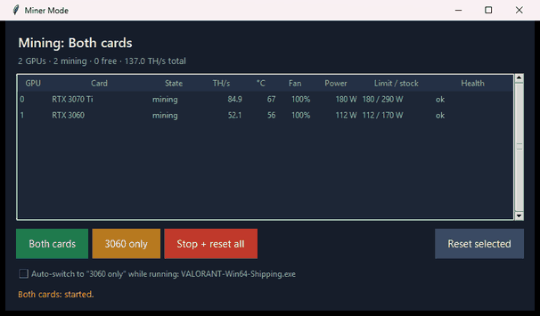
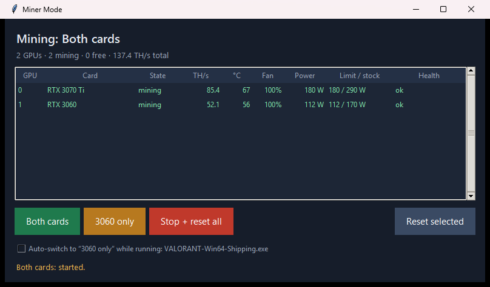
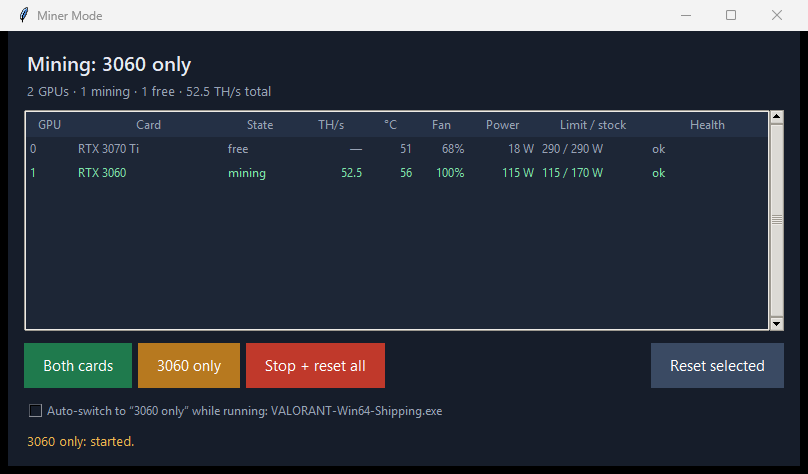
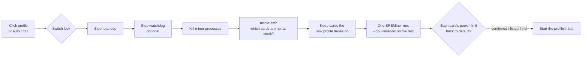

# ⛏️ Miner Mode

**One click to free your GPUs for gaming or AI, and one click to put them back to work, on 2 GPUs or 200.**

Miner Mode is a Windows control panel for [SRBMiner-Multi](https://github.com/doktor83/SRBMiner-Multi) rigs on NVIDIA cards. It switches the rig between your mining profiles, **puts every freed GPU back to stock clocks** (SRBMiner leaves its overclock applied when it exits), watches every card's health, switches automatically when a game starts, and has a command line for schedulers and fleets.



*Real recording on a 2-GPU rig (RTX 3070 Ti + RTX 3060): switch to "3060 only", where the 3070 Ti returns to 290/290 W stock, then back to "Both cards", where the overclock (180 W) and hashrate come back.*

---

## The problem

You mine on your PC, and sometimes you want a GPU back. Before Miner Mode, that meant:

1. Close the miner
2. Edit the `.bat` to drop a card, and run it again
3. Open MSI Afterburner and **reset the freed card**, because SRBMiner leaves the core/memory offsets, power limit and fan speed applied after it exits. A 3070 Ti stays capped at 180 W instead of 290 W, mid-game.
4. Play, then do it all again in reverse

Miner Mode turns that into one click, and it can do it on its own when the game starts.

---

## ✨ Features

### 🔀 Profiles: any number of modes, one button each
Define as many profiles as you like in `config.json` (full rig, "3060 only", "Rack A off", "Night mode"…). Each profile names a `.bat` and the GPUs it mines on. Every profile gets a button, and **Stop + reset all** is always there.

On every switch, Miner Mode:
1. stops the `.bat` restart loop first, so the old miner can't respawn mid-switch, then your watchdog (optional), then every miner process
2. resets **only** the cards the new profile won't use, **skipping cards already at stock** (fast on big rigs)
3. starts the new profile's `.bat` in a real console, exactly like a double-click

### 🧹 Verified return to stock, without Afterburner
Freed cards are reset by a short SRBMiner run with its own `--gpu-reset-oc`, **all of them in one run**. Success is **checked on the card itself**: the reset counts only when `nvidia-smi` reports the card's default power limit again. Anything not confirmed in time is listed by bus address in the window and the log, never silently assumed.

### 🩺 Per-GPU health monitor *(new)*
A live table of every GPU, refreshed every few seconds: **state, TH/s, temperature, fan, power draw, power limit vs. stock and health**. Rows are colour-coded and flagged:

| Flag | Meaning |
|---|---|
| `HOT` | at or above your `hot_c` temperature |
| `0 H/s` | assigned to mining but not hashing (stuck or crashed card) |
| `OC left on` | free, but still on mining settings: one click to fix |

Select any free cards (Ctrl/Shift-click) and press **Reset selected** to put just those back to stock. The header sums it up: *"200 GPUs · 180 mining · 20 free · 18,240.5 TH/s total · ⚠ 3 need attention"*.

### 🎮 Auto-switch for games and AI *(new)*
Tick **Auto-switch** and list the programs that need a GPU (for example `VALORANT-Win64-Shipping.exe`, or your LLM server):
- when one starts → switch to your chosen profile (e.g. "3060 only"), and the freed card is reset to stock before the game loads
- when they've all been closed for `back_after_s` (default 2 min) → switch back
- it only undoes **its own** switch: if the rig was already on that profile, it leaves it alone
- clicking any button cancels the auto-switch: **your click always wins**

### 🖥️ Command line for schedulers and fleets *(new)*
The same app runs headless:

```text
> python miner_mode.pyw --status
Mode: 3060 only | 52.5 TH/s
  GPU0   01:00.0  RTX 3070 Ti            free                 54C  290/290 W  ok
  GPU1   02:00.0  RTX 3060               mining    52.5 TH/s  54C  115/170 W  ok

> python miner_mode.pyw --profile "3060 only"
Stopping current miner...
Resetting 1 GPU(s) to stock...
3060 only: started.
```

| Command | Does |
|---|---|
| `--status` | Mode and one line per GPU |
| `--status --json` | The same, as JSON for dashboards and fleet scripts |
| `--profile "NAME"` | Switch to a profile |
| `--stop` | Stop mining and reset every GPU to stock |
| `--reset 0,3,7` | Reset these GPUs (nvidia-smi indexes) to stock |

Exit code `0` = success, `1` = a reset couldn't be confirmed, `2` = config problem. Pair it with **Windows Task Scheduler**: for example, `--stop` at the start of peak-tariff hours and `--profile "Full rig"` when they end. Or call it over SSH on every rig in a farm.

### 🏗️ Built for big rigs
- **GPUs are matched by PCI bus address**, not by number. SRBMiner's `GPU0` and nvidia-smi's `0` are often different cards on multi-GPU risers, so a wrong reset is impossible by design.
- **One `nvidia-smi` call** reads every card each refresh. Table rows are updated in place, so 200 rows stay smooth, and the table scrolls.
- **Resets are batched**: one SRBMiner run for all freed cards, a timeout that grows with the card count, and cards already at stock skipped.
- **Switch lock (named mutex)**: the window, the command line and a scheduled task can never switch at the same time. A second switch waits for the first.

### 🛡️ Safe by default
- **Never edits your `.bat` files or overclock values.** It only chooses which `.bat` runs.
- **One window only.** A second launch says "Miner Mode is already open".
- **Clicks during a switch are ignored**, and the buttons grey out until it's done.
- **Clear config errors.** A broken `config.json` opens a message box explaining what's wrong, instead of the window silently not appearing.
- **Everything is logged** to `miner_mode.log`: every switch, auto-switch, reset result and error, with timestamps.
- **No secrets in git**: your wallet and paths live in `config.json`, which is git-ignored.

### 🪶 No dependencies
One Python file, standard library only (`tkinter`, `ctypes`, `subprocess`, `urllib`, `json`, `csv`), plus NVIDIA's `nvidia-smi`. No `pip install`, no service, no admin rights for normal use.

---

## 📸 Screenshots

| Both cards mining | One card freed for gaming |
|---|---|
|  |  |
| Overclock on: 3070 Ti at 180 / 290 W | 3070 Ti back at 290 / 290 W stock, 3060 still mining |

---

## 🧭 How a switch works



---

## 🚀 Setup

### Requirements
- Windows 10/11, NVIDIA driver (`nvidia-smi`)
- Python 3.10+ ([python.org](https://www.python.org/downloads/) build, which includes tkinter)
- SRBMiner-Multi with `--api-enable` support (any recent version)

### 1. Get it
```bat
git clone https://github.com/sakshay2318/miner-mode.git
cd miner-mode
python test_miner_mode.py
```

### 2. One `.bat` per profile, in your SRBMiner folder
Each loops the miner with `--api-enable` (for live hashrate). Restrict cards with `--gpu-id`. All names must contain your `loop_match` text.

```bat
@echo off
cd %~dp0
:loop
SRBMiner-MULTI.exe --algorithm-gpu pearlhash --pool <pool:port> --wallet <wallet.worker> ^
  --gpu-id 1 --gpu-coffset0 240 --gpu-moffset0 -502 --gpu-plimit0 115 --gpu-fan0 100 ^
  --api-enable --log-file miner.log --log-file-mode 1
timeout /t 30 /nobreak
goto loop
```
*(Overclock values are examples: use your own.)*

### 3. `config.json`
Copy `config.example.json` to `config.json`:

```json
{
  "miner_dir": "C:\\Miners\\SRBMiner-Multi-3-8-3",
  "algorithm": "pearlhash",
  "pool": "pool.example:7048",
  "wallet": "YOUR_WALLET.worker",
  "profiles": [
    {"name": "Both cards", "bat": "C:\\Miners\\SRBMiner-Multi-3-8-3\\start-mining-pearl.bat", "gpus": "all"},
    {"name": "3060 only",  "bat": "C:\\Miners\\SRBMiner-Multi-3-8-3\\start-mining-pearl-3060-only.bat", "gpus": [1]}
  ],
  "auto": {"enabled": false, "apps": ["VALORANT-Win64-Shipping.exe"], "profile": "3060 only", "back_to": "Both cards", "back_after_s": 120},
  "loop_match": "start-mining-pearl"
}
```

| Key | Meaning | Default |
|---|---|---|
| `miner_dir` | SRBMiner folder | *required* |
| `algorithm`, `pool`, `wallet` | Used only for the few-second reset run | *required* |
| `profiles[]` | `name`, `bat`, and `gpus`: `"all"` or a list of **SRBMiner** GPU ids (`--list-devices`) | *required* |
| `auto.enabled` | Auto-switch checkbox starts ticked | `false` |
| `auto.apps` | Process names that trigger the auto-switch | `[]` |
| `auto.profile` / `auto.back_to` | Profile while they run / profile to return to (blank = the previous one) | — |
| `auto.back_after_s` | Seconds after the last app closes before switching back | `120` |
| `loop_match` | Text in all profile `.bat` names, used to stop the running loop | `start-mining` |
| `watchdog_match` | Text in a watchdog's command line, stopped before a switch | `""` (none) |
| `hot_c` | Temperature for the `HOT` flag | `83` |
| `poll_s` | Refresh interval in seconds | `5` |
| `api` | SRBMiner API | `http://127.0.0.1:21550` |
| `log_file` | Log next to the app | `miner_mode.log` |

Windows paths in JSON need **double backslashes**. A config from the first version (`both_bat` / `single_bat`) still loads.

> **Tip:** don't put programs that start with Windows (LM Studio's background service, launchers) in `auto.apps`, or the rig will never switch back. Use the process that actually holds the GPU: the game itself, or your LLM server.

### 4. Desktop shortcut
Target: `"C:\Path\To\Python\pythonw.exe" "C:\Path\To\miner-mode\miner_mode.pyw"`, named "Miner Mode".

---

## 🩺 Troubleshooting

| Symptom | Fix |
|---|---|
| Message box "config problem" | Read the message: usually single backslashes in a path, or a missing key |
| "miner not answering" / TH/s shows `—` | The miner is starting (≈1 min), or `--api-enable` is missing from the `.bat` |
| "Reset NOT confirmed on N GPU(s)" | Check `miner_dir` / `pool` / `wallet`, then reset those cards once in Afterburner. The bus addresses are in the message and `miner_mode.log` |
| Mode shows "Not mining" while mining | The running `.bat` isn't one of your profiles, or its name doesn't contain `loop_match` |
| The old miner restarts after a switch | Something else restarts it: set `watchdog_match` |
| Auto-switch never switches back | A listed app is still running in the background (see the tip above) |

## ⚠️ Limits
- **Windows + NVIDIA + SRBMiner-Multi only.**
- The reset is **confirmed through the power limit**. Core/memory offsets and fan are reset by the same SRBMiner call, but `nvidia-smi` can't read offsets back, so they aren't checked separately.
- The reset run connects to your pool for a few seconds on the freed cards. That's harmless, but it may show as a short session on the pool.

## 🧪 Tests
```bat
python test_miner_mode.py
```
Runs without a GPU and covers: bus-address matching (including a simulated **100-GPU rig where SRBMiner and nvidia-smi order differ**), nvidia-smi and SRBMiner API parsing (`[N/A]` fields), mode detection, choosing which cards to reset (skipping cards at stock), health flags, the auto-switch rules (switch in, switch back, manual override, nothing to undo), and config validation, including old-format configs.

Also checked end to end on a real 2-GPU rig: profile switching both ways, double switching, stop + reset (twice), a miner window closed by hand, double-clicks, the single window, and the command line.
